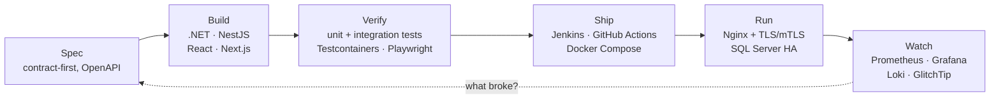

# Hi, I'm Mohannad 👋

**Full-stack developer who also owns the path to production.**
I build backends and frontends, then ship, run and watch them. Nearly 4 years on platforms for government and enterprise teams across Egypt and the Gulf. Cairo.

## How a feature reaches production, the way I do it



## The toolbox

```console
mohannad@cairo:~$ cat stack.yml
languages:     [C#, TypeScript, Python]
backend:       [ASP.NET Core, EF Core, NestJS, FastAPI]
frontend:      [React, Next.js, Tailwind CSS]
data:          [SQL Server, MongoDB, PostgreSQL, RabbitMQ, MinIO]
delivery:      [Jenkins, GitHub Actions, Docker Compose, Nexus]
edge:          [Nginx, HAProxy, TLS / mTLS]
observability: [Prometheus, Grafana, Loki]
automation:    [n8n, Claude Code, LLM APIs]
learning:      [Kubernetes, Go]
```

## Things I'm proud of

- A delivery pipeline for a multi-service platform: isolated Compose test slots, real-database integration tests, automatic deploys after green builds.
- Failover and failback for a production host, with split-brain guards and a runbook, tested.
- A TLS edge with mutual TLS per client application, a route allowlist and audit logging.
- Self-hosted n8n workflows that watch pull requests and builds and ask Claude to analyse problems, with a human approving every fix.

## Find me

[🌐 mohannadragab.dev](https://www.mohannadragab.dev/) · [✉️ contact@mohannadragab.dev](mailto:contact@mohannadragab.dev) · [LinkedIn](https://www.linkedin.com/in/mohannad-ragab/)

<p align="center">
  
</p>

<sub>Most of my work lives in private repositories. The pinned projects are the public ones I can show.</sub>
