## About me

I'm a full stack developer who also owns the path to production. I build .NET and NestJS backends with React and Next.js frontends, then ship them through CI/CD, run them on Docker behind Nginx and TLS, and watch them with Prometheus and Grafana.

For the last few years that has meant government and enterprise platforms in Egypt, Saudi Arabia and Qatar: Arabic-first, bilingual, often air-gapped, and expected never to go down. I like the boring parts that keep things up: failover, backups, runbooks, and alerts that tell the team what broke before users do.

## By the numbers

## Things I've built

| Project | What I did | Stack |
|---|---|---|
| **Board-meeting platform with video conferencing** | Sole developer of the meetings service: turned self-hosted Jitsi into a managed platform with JWT join tokens, guest links, a waiting room, recordings and server-side room policies written as Prosody (Lua) modules | .NET 9 · Jitsi · RabbitMQ · MinIO |
| **Multi-tenant ERP for the Saudi market** | Lead developer: accounting, procurement, payroll and fixed assets, ZATCA Phase 2 e-invoicing, and journal entries posted automatically from business events | NestJS · Next.js · MongoDB |
| **Bilingual government HR and executive portal** | Built the portal and back office, ran the production cutover to two API and two frontend nodes behind a load balancer, and made RabbitMQ and MinIO highly available | Next.js · ASP.NET Core · SQL Server · HAProxy |
| **Councils and committees system** | A contract-first modular monolith, with CI on self-hosted runners: isolated Compose slots, Playwright end-to-end tests and SQL Server integration tests | .NET 10 · Next.js 16 · SQL Server |
| **Warm-standby production host and TLS edge** | Failover and failback with split-brain guards for a 20-service platform, plus an Nginx API gateway with an internal CA and mutual TLS per client app | Nginx · Docker · Linux |
| **Team alerts and AI code review** | Workflows that watch pull requests, builds and deploys, alert on Telegram, and let a sandboxed Claude session analyse the problem or propose a fix, applied only after human approval | n8n · Claude · Telegram |
| **AI chatbot with 5,000+ daily users** | Co-built the bot, payments, moderation and integrations with 5+ AI providers for chat, image and video | Vue 3 · TypeScript · Go |

## Stack

## Contributions

## Learning

Most of my work lives in private and organisation repos. The heatmap counts it, and it refreshes every day.

